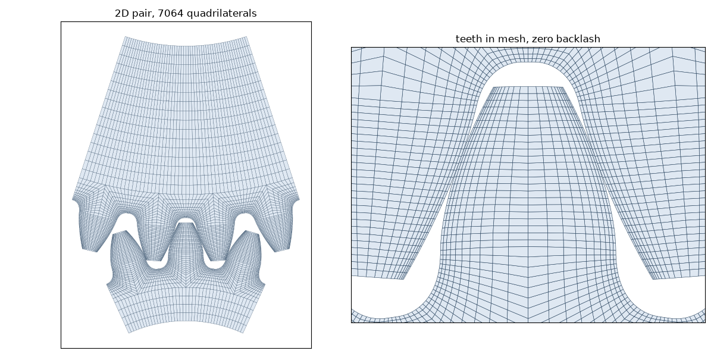

# python-gearbox

Strength calculation and finite-element geometry export for **spur and helical involute gears**.

* Surface durability (pitting) and tooth root strength (bending) according to
  **ISO 6336:2019** (parts 1, 2 and 3, Method B) and **AGMA 2001-D04** (with the AGMA 908-B89
  geometry factors).
* Profile shift (addendum modification) helpers.
* One-tooth 2D/3D geometry export for **MATLAB/COMSOL**, **ABAQUS** and **ANSYS**.
* Structured quad/hex finite-element meshes of gear sectors and gear pairs with **Gmsh**
  (`pip install python-gearbox[fem]`), written as `.msh`/`.inp` with named node and element sets.
* Tooth bending (`gearbox.fem.solve_bending`) and tooth contact of a gear pair
  (`gearbox.fem.solve_contact`) with **CalculiX**, see [Finite elements](#finite-elements).

> **Status:** version 0.2 is a refactor of the original code (Python ≥ 3.11, typed immutable models,
> descriptive names, test suite) and an update of the ISO 6336 implementation from the 2006 to the
> **2019 edition**. Numbers therefore differ from 0.1.x: every change is listed in
> [KNOWN_ISSUES.md](KNOWN_ISSUES.md) with its effect. Flank tolerances follow ISO 1328-1:2013. Read the
> known issues before relying on the numbers.

## Scope

| Standard | Implemented | Not implemented |
|----------|-------------|-----------------|
| ISO 1328-1:2013 | flank tolerances `f_pT`, `F_pT`, `F_αT`, `F_βT`, `f_fαT`, `f_HαT`, `f_HβT`, `f_fβT` (formulae 5-12) | runout, tooth thickness |
| ISO 6336-1:2019 | `K_A`, `K_γ` (given), `K_v` by method B, method C or a measured value (A), `K_Hβ`/`K_Fβ` (method C), `K_Hα`/`K_Fα` (method B), tooth stiffness `c'`, `c_γα`, `c_γβ` (method B) | method A/B of `K_Hβ`, `K_v` method B for internal gears, multi-mesh resonance (idlers, planets) |
| ISO 6336-2:2019 | pitting, method B, reference, limited-life and static stress (`Z_H`, `Z_E`, `Z_ε`, `Z_β`, `Z_B`, `Z_D`, `Z_NT` with and without limited pitting, `Z_L`, `Z_v`, `Z_R`, `Z_W`, `Z_X`); internal and double helical gears | the standard gives no formula for `Z_B`/`Z_D` when `ε_α > 2` (clause 6.4), which raises no error but is outside the validated range |
| ISO 6336-3:2019 | tooth breakage, method B, external gears cut with a hob or a shaper cutter and internal gears cut with a shaper cutter; double helical gears; reference, limited-life and static stress; `Y_Sg` for grinding notches | the graphical `Y_δrelT` for static stress of `St` without a yield point |
| AGMA 2001-D04 / 908-B89 | pitting and bending stress, `I` and `J` (checked against the 908-B89 tables), `K_v`, `K_s`, `K_m`, `K_B`, `K_o`; allowable stresses and safety factors with `Z_N`, `Y_N`, `C_H`, `K_T`, `K_R` when `s_ac`/`s_at` are given; pitting of internal gears | bending of internal gears (908-B89 gives no `J`), double helical gears, cast-iron stress cycle factors, the critical-service curves of `Z_N`, `s_ac`/`s_at` tables (the numbers must be supplied) |

## Limitations and pending work

Not implemented; each item that depends on a missing source says which one. Details in
[KNOWN_ISSUES.md](KNOWN_ISSUES.md).

* **Internal gears:** AGMA bending (AGMA 908-B89 gives no `J`), `K_v` method B (ISO 6336-1 only gives
  the reduced mass of external teeth and of planetary stages), tooth interference checks between
  pinion and ring (needs ISO 21771), profile shift optimisation and geometry export. These raise
  `ValueError`.
* **Double helical gears:** ISO 6336 only. AGMA raises `ValueError`: the AGMA 2001-D04 clauses on face
  width and `K_m` for this type were not available to check the formulae.
* **Contact ratio:** the limits by the active root diameter (ISO 6336-2 formulae 34-35) are not
  applied; they need ISO 21771 data. Formula (33) (base circle) is.
* **ISO 6336-2:** `Z_B`, `Z_D` for `ε_α > 2` (the standard gives no formula).
* **ISO 6336-1:** methods A and B of `K_Hβ`, multi-mesh dynamics (idlers, planetary stages).
* **ISO 6336-3:** graphical `Y_δrelT` for static stress of `St` without a yield point.
* **AGMA 2001-D04:** cast-iron `Z_N`/`Y_N`, the critical-service edge of `Z_N`; the `s_ac`/`s_at`
  tables are inputs.
* **ISO 1328-1:** runout and tooth thickness tolerances.
* **FEM and export:** external gears only; the tooth form is generated by a rack, so protuberance
  tools (`s_pr`) and shaper cutters are not reproduced (KI-41). The analyses are linear elastic and
  frictionless and were validated in 2D only. `solve_contact` also runs in 3D, but a coarse mesh
  (fine enough to finish in about half an hour for a spur pair) overestimates the contact pressure
  by some 15 %, and the fine mesh needed in 3D is very expensive.

## Install

```bash
pip install python-gearbox          # released version
pip install -e ".[dev]"             # development checkout (pytest, ruff)
```

## Quick start

```python
from gearbox import Gear, Lubricant, Material, MaterialType, ShaftArrangement, Tool, Transmission
from gearbox.standards import iso6336

tool = Tool(addendum_coefficient=1.0, dedendum_coefficient=1.25, root_fillet_radius_coefficient=0.38)
steel = Material(
    material_type=MaterialType.NITROCARBURIZED_STEEL,
    contact_stress_limit=1500.0, bending_stress_limit=460.0, brinell_hardness=286.7,
)
pinion = Gear(
    tool=tool, material=steel, number_of_teeth=22, module=2.5, face_width=34.0,
    quality_grade=6, surface_roughness=3.67, shaft_diameter=35.0,
    shaft_arrangement=ShaftArrangement.BETWEEN_BEARINGS_TOWARDS_TORQUED_END,
    bearing_span=60.0, offset=15.0, favorable_contact=True,
)
wheel = Gear(
    tool=tool, material=steel, number_of_teeth=40, module=2.5, face_width=34.0,
    quality_grade=6, surface_roughness=3.67, shaft_diameter=50.0,
    shaft_arrangement=ShaftArrangement.BETWEEN_BEARINGS_TOWARDS_TORQUED_END,
    bearing_span=60.0, offset=35.0, favorable_contact=True,
)
transmission = Transmission(
    pinion=pinion, wheel=wheel, lubricant=Lubricant(kinematic_viscosity_40c=160),
    pinion_speed_rpm=1450.0, power_kw=40.0, design_life_hours=10_000.0, application_factor=1.3,
)

result = iso6336.calculate_pitting(transmission)
print(result.contact_stress_pinion, result.safety_factor_pinion)
```

Units: lengths in mm, angles in degrees, stresses in MPa, power in kW, speed in rpm.

Double helical gears: `Gear(double_helical=True, face_width=b_B, helix_angle=…)` on both gears, with
`face_width` the width of *each* helix (ISO 6336 only). Internal gears: `Gear(internal=True)` on the
wheel, `number_of_teeth` positive, cut with a shaper (`Tool(cutter_type="shaper", cutter_teeth=…)`)
for the bending calculation; the dynamic factor needs `dynamic_factor_method="C"`. Details and
limits in [KNOWN_ISSUES.md](KNOWN_ISSUES.md) (KI-38, KI-39).

Inputs that select a table of the standard are enums with descriptive members instead of numeric
codes: `MaterialType`, `ShaftArrangement` (ISO 6336-1 figure 13), `LeadModification` (table 12),
`FlankModification` (ISO 6336-2 table 3, helical pairs), `Crowning`, `AssemblyCondition` and
`GearingType` (AGMA). Helical pairs default to `FlankModification.NONE` (`f_ZCa = 1.2`, the
conservative case); set `Transmission(flank_modification=...)` when the flanks are modified.

All models are immutable; derive variants with `dataclasses.replace`. Results are frozen
dataclasses whose fields use full names (`life_factor_pinion`, `dynamic_factor`, …) with the
standard's symbol in each field's docstring.

## Finite elements

`gearbox.fem` (`pip install python-gearbox[fem]`) builds structured quadrilateral (2D) and
hexahedral (3D) Gmsh meshes of a gear sector or of a gear pair in mesh, and solves them with
**CalculiX**, an external program: `conda install -c conda-forge calculix` or
`apt install calculix-ccx`, then put `ccx` on the `PATH` or set `GEARBOX_CCX`. The tooth form is
the one the hob generates, root fillet included (KI-41), and the node and element sets are named
(`FLANK`, `FILLET`, `BORE`, `TOOTH2_FLANK_CCW`, …).


 

Two block layouts are available (`ToothMeshSettings(variant=...)`). The default,
`"fillet_block"`, ends the flank block on the root form circle and gives the fillet a block of its
own, split where the profile tangent makes 30° with the tooth axis (the ISO 6336-3 critical
section): the element size there is controlled independently and the neck of an undercut tooth is
meshed evenly. `"standard"` meshes the root and the fillet in one block:




```python
from gearbox.fem import mesh_gear, mesh_pair, solve_bending, solve_contact

mesh_gear(pinion, "out", "pinion", "3D", teeth=3, formats=("msh", "inp"))
bending = solve_bending(pinion, "out", tangential_force=8000.0, dimension="2D")
contact = solve_contact(transmission, "out")  # pitch point, nominal Ft of the transmission
print(bending.max_principal_stress, contact.max_contact_pressure, contact.max_root_stress_pinion)
```

* `solve_bending` loads one tooth with a pressure band on the flank and fixes the bore. In 2D,
  loaded at the outer point of single pair contact, the root stress is within 2-12 % of ISO 6336-3
  method B (`Y_F·Y_S·F_t/(b·m_n)`).
* `solve_contact` turns the pinion bore against the fixed wheel bore until the pinion torque is
  `F_t·d_1/2`, with frictionless penalty contact between the flanks. At the pitch point of a spur
  pair the contact pressure is within 1 % of Hertz' theory. `pinion_rotation` sets the mesh
  position, so the whole path of contact can be followed, as in the animations below (2D, spur
  `z = 22/40`, `m = 2.5`, `F_t = 8000 N`, `b = 34 mm`; grey bands: two pairs of teeth in contact).


The left panels draw the classic scheme of the mesh over the stresses: base circles (dashed),
working pitch circles (dotted), the line of action `T1 T2` and the path of contact `A-E` in
magenta, with the single contact zone `B-D`. Along the path:

* in the grey zones two pairs share the load, so the contact pressure lies between Hertz with the
  whole load and with half of it, and the root stresses stay low;
* between `B` and `D` one pair carries everything: the contact pressure follows Hertz with the
  whole load and the root stresses peak;
* just outside `A` and `E` the sharp tip edge of the leaving or entering tooth still touches,
  because the teeth deflect under load (the reason for tip relief); the pressure there is
  singular and depends on the mesh, so it is drawn off scale.

The lines of the standards are drawn for reference only: they are the nominal values of each
method with all load factors equal to 1 (ISO 6336-3 `Y_F·Y_S`, AGMA 908 `1/J` and the cantilever
beam `Y_F` for bending; Hertz, ISO 6336-2 `Z_H·Z_E` with and without `Z_ε` and AGMA 2001 `C_p`, `I`
for contact). Each standard places its load at a different point and simplifies differently, so
they are not expected to match the curve of the FEM. The figures are made by
[`docs/figures/make_figures.py`](docs/figures/make_figures.py).

`gearbox.fem.post` holds the post-processing used for these figures (matplotlib comes with the
`fem` extra): `LineOfAction` (points `T1 A B C D E T2`, single and double contact zones, Hertzian
pressure along the line, the mesh position for a point of the line), `contact_sweep` (the contact
solved along the path of contact, cached), `contact_patches` (the contact of each tooth, with tip
edge contacts outside `A-E` flagged), and `plot_mesh`, `plot_field`, `plot_line_of_action` to
draw on a matplotlib axes.

```python
import matplotlib.pyplot as plt
from gearbox.fem.post import LineOfAction, contact_sweep, plot_field, plot_line_of_action

line = LineOfAction.of(transmission)
points = contact_sweep(transmission, "sweep", [line.points()["A"] + 0.2, 0.0])
fig, ax = plt.subplots()
plot_field(ax, points[1].stress("von_mises"))
plot_line_of_action(ax, line, points[1].followed.point)
```

## Examples

| File | Shows |
|------|-------|
| [`examples/01_basic_calculation.py`](examples/01_basic_calculation.py) | ISO 6336 and AGMA 2101 checks of a spur pair |
| [`examples/02_helical_gears_and_what_if.py`](examples/02_helical_gears_and_what_if.py) | spur vs helical, parameter sweeps with `replace` |
| [`examples/03_profile_shift_optimization.py`](examples/03_profile_shift_optimization.py) | profile shift scan and optimisation |
| [`examples/04_export_geometry.py`](examples/04_export_geometry.py) | COMSOL / ABAQUS / ANSYS export |
| [`examples/05_fem_mesh.py`](examples/05_fem_mesh.py) | Structured Gmsh meshes (sector and pair) |
| [`examples/06_fem_bending.py`](examples/06_fem_bending.py) | Root stress of a tooth with CalculiX |
| [`examples/07_fem_contact.py`](examples/07_fem_contact.py) | Contact of a spur pair with CalculiX, against Hertz |

## Migrating from 0.1.x

| 0.1.x | 0.2 |
|-------|-----|
| `Gear(z=…, m=…, x=…, b=…, bs=…, sr=…, rz=…, precision_grade=…, schema=…, l=…, s=…, gear_crown=…, helix_modification=…, gear_condition=…)` | `Gear(number_of_teeth, module, profile_shift_coefficient, face_width, web_thickness, rim_thickness, surface_roughness, quality_grade, shaft_arrangement, bearing_span, offset, crowning, lead_modification, assembly_condition)` |
| `Transmission(gears=[g1, g2], rpm_in, p, l, ka, sh_min, sf_min, gear_box_type)` | `Transmission(pinion, wheel, pinion_speed_rpm, power_kw, design_life_hours, application_factor, min_safety_factor_pitting, min_safety_factor_bending, gearing_type)` |
| `iso.Pitting(t).calculate()['sigmaH']` | `iso6336.calculate_pitting(t).contact_stress_pinion` |
| `agma.Bending(t).calculate()['sigmafone']` | `agma2101.calculate_bending(t).bending_stress_pinion` |
| `Optmization(t).bending()` | `optimization.maximum_profile_shifts(t)` / `minimum_contact_stress_profile_shifts(t)` |
| `ExportGear(g).matlab_comsol(…)` | `export.export_gear(g, ExportTarget.COMSOL, …)` |
| `helix_modification=1…5` | `LeadModification`; numbering of ISO 6336-1:2019 table 12: old 1 and 2 are unchanged, old 3, 4, 5 are now `HELIX_CORRECTION` (4), `HELIX_CORRECTION_AND_CENTRAL_CROWNING` (5), `END_RELIEF` (6) |
| `schema=1…5` | `ShaftArrangement` (same numbers, now named after figure 13 a to e) |

## Development

```bash
pytest
ruff check . && ruff format --check .
```

Two kinds of tests protect the numbers:

* **Behavioural tests** (`tests/test_iso6336_*_2019.py`, `test_agma2101_fixes.py`, …) check each
  factor against the formulae of the standard, with the clause number in the comment.
* **Golden tests** (`tests/golden/`) pin the full results of six reference scenarios.
  `tests/golden/baseline_original.json` holds the numbers of the original 0.1.x code for
  provenance; `reference.json` is the current reference and is regenerated with
  `python tests/golden/regenerate_reference.py`. A change that moves it must be intentional and
  explained in the commit and in [KNOWN_ISSUES.md](KNOWN_ISSUES.md).

The standards themselves are not distributed with the repository. The calculation was reviewed
against ISO 6336-1/-2/-3:2019, AGMA 2001-D04 and ISO 6336-5:2016; see `KNOWN_ISSUES.md` for what is
still pending.

## Contributing

See [CONTRIBUTING.md](CONTRIBUTING.md), the [Code of Conduct](CODE_OF_CONDUCT.md) and the
[security policy](SECURITY.md). Changes are listed in [CHANGELOG.md](CHANGELOG.md).

## License

LGPL 2.1 — see [LICENSE](LICENSE).

## Citing

If you use Python-Gearbox for academic research, please use the following:

**BibTeX:**
```
@misc{https://doi.org/10.5281/zenodo.3660527,
  doi = {10.5281/ZENODO.3660527},
  url = {https://zenodo.org/record/3660527},
  author = {Donéstevez, Eduardo Miguel Fírvida},
  keywords = {gearbox, gear transmissions, gears, ISO-6336, AGMA-2101 D04, Gear stresses calculation},
  language = {en},
  title = {Python library for design of spur and helical gears transmissions},
  publisher = {Zenodo},
  year = {2020}
}
```

**APA:**
```
Donéstevez, E. M. F. (2020). Python library for design of spur and helical gears transmissions (Version 1.0). Zenodo. https://doi.org/10.5281/ZENODO.3660527
```

**IEEE**
```
E. M. F. Donéstevez, “Python library for design of spur and helical gears transmissions.” Zenodo, 09-Feb-2020, doi: 10.5281/ZENODO.3660527.
```
