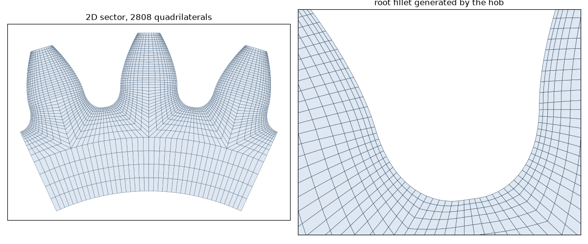

# Finite element model

The standards reduce a tooth to a handful of factors. The `gearbox.fem` package lets you look at
the tooth itself: it meshes the exact shape the hob cuts, root fillet included, and solves it with
{ref}`CalculiX <ref-calculix>`. You get the stress field of a loaded tooth, the contact pressure
between two flanks, and the way both change while a tooth rolls through the mesh.

```python
from gearbox.fem import solve_bending, solve_contact

bending = solve_bending(transmission, "out", dimension="2D")   # root stress at the point D
contact = solve_contact(transmission, "out")                   # contact pressure at the pitch point
print(bending.max_principal_stress, contact.max_contact_pressure)
```

Here `transmission` is the pair of {doc}`../quickstart`: a 22/40 spur pair of
module 2.5. The first call gives 318 MPa at the root of the pinion, the same as ISO 6336-3 to within
0.1 %. The second gives 1338 MPa, within 0.3 % of Hertz' theory.



::::{grid} 1 2 2 2
:gutter: 3

:::{grid-item-card} Overview and requirements
:link: overview
:link-type: doc

What you need to install, the workflow from mesh to results, what has been validated and where
the limits are.
:::

:::{grid-item-card} Meshing
:link: meshing
:link-type: doc

Structured quad and hex meshes of one gear or a pair in mesh: the blocks, the element sizes, the
named groups, the output files.
:::

:::{grid-item-card} Bending analysis
:link: bending
:link-type: doc

`solve_bending`: one tooth loaded at the outer point of single pair contact, the root stress and
how it compares with ISO 6336-3.
:::

:::{grid-item-card} Contact analysis
:link: contact
:link-type: doc

`solve_contact`: a pair pressed together by a torque, the contact pressure and Hertz' theory as
the reference.
:::

:::{grid-item-card} Three-dimensional FEM
:link: three-dimensional
:link-type: doc

Hexahedral meshes, helical twist, 3D bending and contact, computational cost and convergence limits.
:::

:::{grid-item-card} Post-processing
:link: postprocessing
:link-type: doc

The line of action, sweeps along the path of contact, contact patches and plots with matplotlib.
:::

:::{grid-item-card} API reference
:link: ../api/index
:link-type: doc

Every class and function of `gearbox.fem.mesh`, `gearbox.fem.calculix` and `gearbox.fem.post`.
:::
::::

```{toctree}
:maxdepth: 2
:hidden:

overview
meshing
bending
contact
three-dimensional
postprocessing
```
