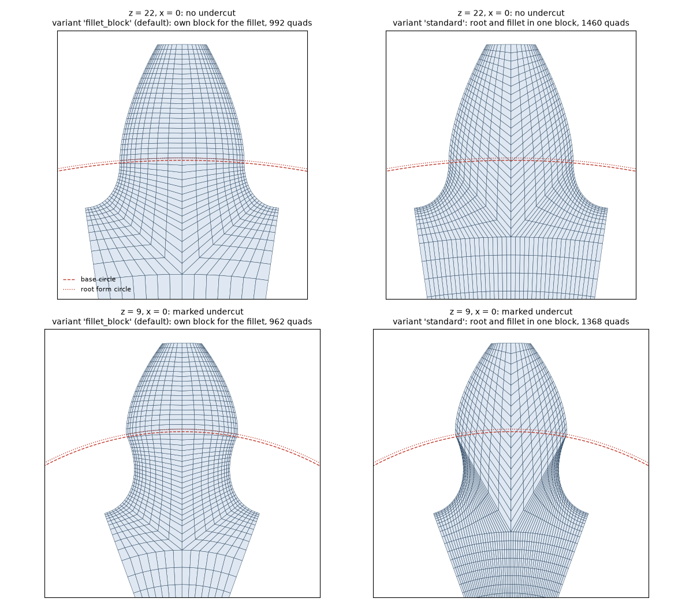
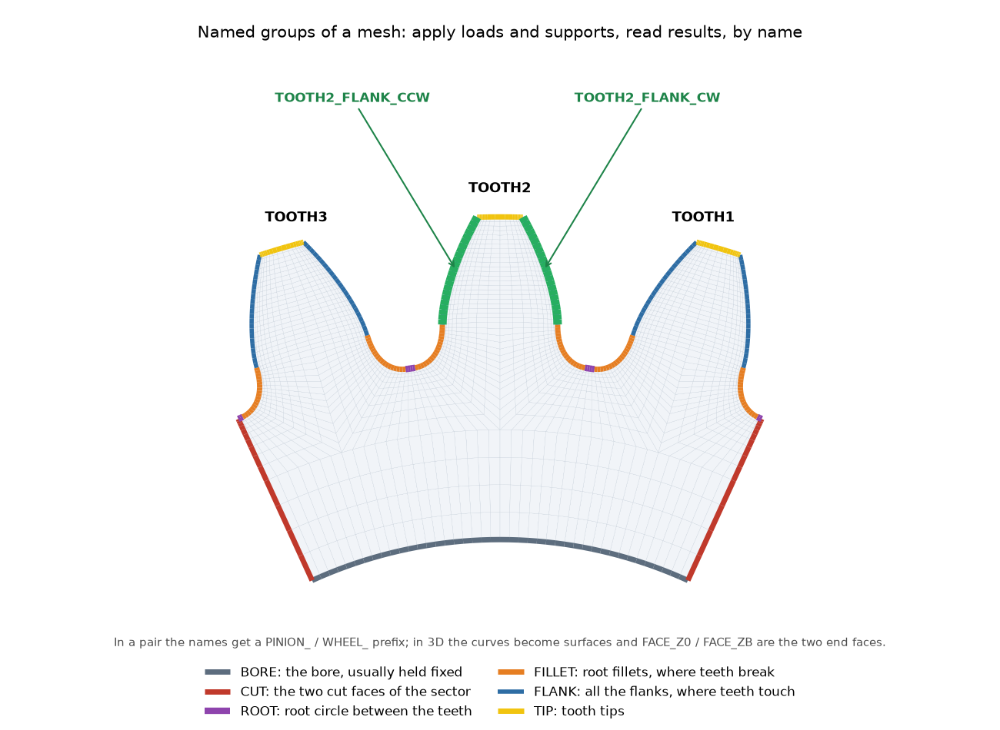

# Meshing

A useful gear mesh spends elements where they matter: along the contacting flank and the root
fillet. The package uses structured transfinite blocks, recombined into quadrilaterals in 2D and
extruded into hexahedra in 3D. The block-structured approach is inspired by
{ref}`GGGears <ref-gggears>`; its code is not used.

```{figure} ../figures/fem/blocks.png
:alt: Block decomposition of a generated half tooth
```

## One gear or a pair

Continue the gear definitions in {doc}`../quickstart`:

```python
from gearbox.fem import ToothMeshSettings, mesh_gear, mesh_pair

settings = ToothMeshSettings(fillet_size=0.04, flank_size=0.06, order=2)
mesh = mesh_gear(pinion, "out", "pinion", "2D", settings, teeth=3)
pair_mesh = mesh_pair(transmission, "out", "pair", "2D", settings,
                      teeth=(3, 4), pinion_rotation=0.0)
print(mesh.node_count, mesh.element_count, mesh.min_quality)
```

`pinion_rotation` is a geometric mesh position in degrees, not the small bore rotation that
loads a contact analysis. At zero mesh rotation the pinion tooth axis lies on the line of centres;
`solve_contact` chooses a different default position so contact occurs at the pitch point.

## Refinement and element quality

Sizes are fractions of normal module. `fillet_size` and `flank_size` control surface resolution;
`tooth_elements` controls the count across half a tooth; `surface_growth` grades elements toward
the interior. `settings.refined(2)` roughly halves sizes and doubles relevant subdivision counts.

The default `fillet_block` layout gives the fillet its own block and closes the flank block at
the root form circle. The alternative `standard` layout combines more of the root region in one
block. Inspect the resulting elements rather than assuming one setting works for every undercut.



`min_quality` is the minimum scaled Jacobian. Nonpositive values indicate invalid or degenerate
elements, but a positive value alone does not establish convergence or penalize every aspect ratio.
Repeat the analysis with refinement and compare the quantity you intend to report.

## Groups and files



Physical groups include `ROOT`, `FILLET`, `FLANK`, `TIP`, `BORE`, `GEAR` and individual
`TOOTH<n>_FLANK_CW/CCW` groups. Partial sectors have `CUT` groups; 3D meshes also have
`FACE_Z0` and `FACE_ZB`. Pair names begin with `PINION_` or `WHEEL_`.

Meshes can be written as `.msh`, `.inp` or `.vtk` via `formats`. These mesh files are part of the
FEM workflow, not the legacy commercial-solver geometry exporters.


3D extrusion twists the transverse section along the helix. Specify `width_elements` to control
layer count; automatic layers based on flank size can make fine 3D contact models very large.
See {py:class}`gearbox.fem.mesh.ToothMeshSettings` for every option.
