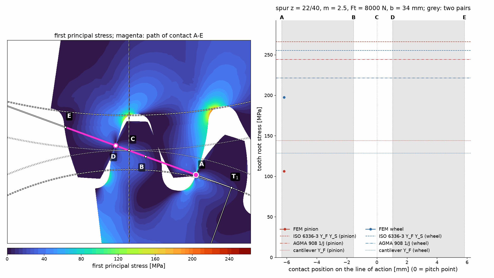
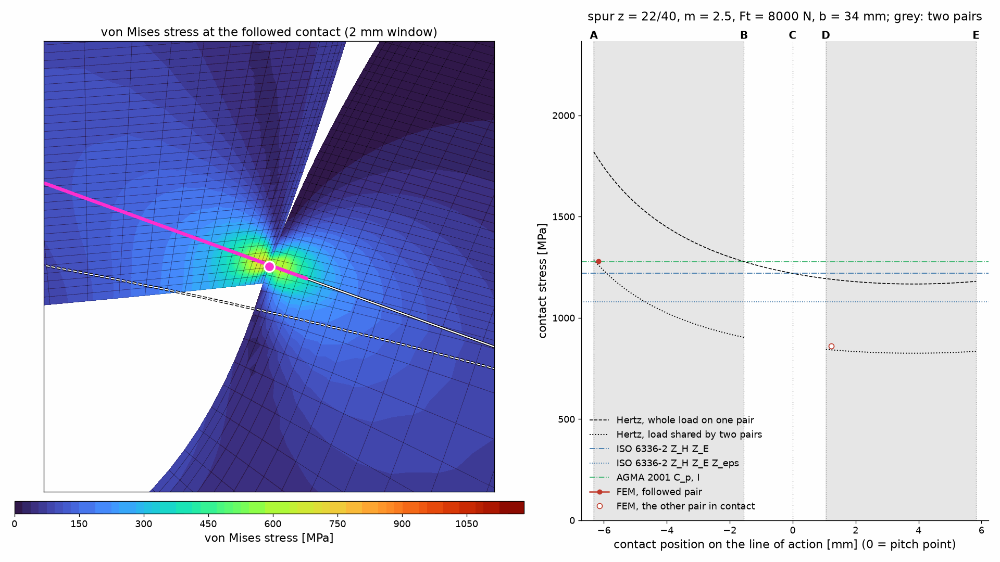
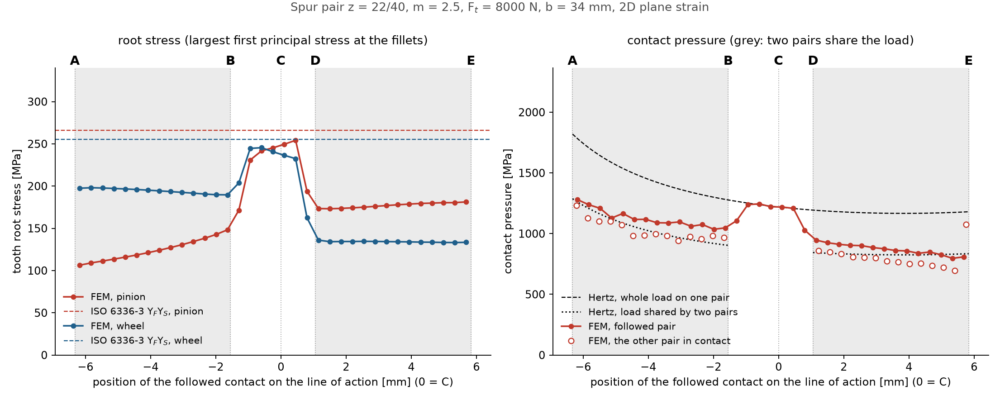

# Post-processing and the full contact cycle

One mesh position tells only part of the story. As a tooth enters and leaves contact, the curvature,
lever arm and number of loaded pairs change. A quasi-static sweep solves these positions separately;
it is not a transient dynamic simulation.

## Positions on the line of action

`LineOfAction.of(transmission)` describes the external pair in the transverse plane. Positions
are measured from pitch point C, positive toward E. A–B and D–E are double-contact regions for
ordinary spur pairs with contact ratio between 1 and 2; B–D is the single-contact region.

```python
from gearbox.fem.post import LineOfAction, contact_sweep

line = LineOfAction.of(transmission)
print(line.points())
# Each requested position invokes a contact solve unless its cache is available.
points = contact_sweep(transmission, "out/sweep", [0.0])
```

A denser sweep gives smoother curves and animations but costs more solver runs. Reuse the same
cache directory to redraw without solving unchanged positions again. The documentation figure
generator requests **35 positions**, up from 18, so its grid retains the old positions and adds
17 intermediate ones. Both generated animations contain 35 frames at 1920 × 1080 pixels, with 200 ms per frame.

## Fields and contact patches

`contact_patches` identifies contacting tooth regions using displaced coordinates.
`nodal_field` and `stress_field` prepare values for plotting; `plot_mesh`, `plot_field` and
`plot_line_of_action` draw on caller-owned matplotlib axes.

```python
import matplotlib.pyplot as plt
from gearbox.fem.post import plot_field, plot_line_of_action

fig, ax = plt.subplots(figsize=(8, 7))
plot_field(ax, points[0].stress("von_mises"))
x, y = line.point(0.0)
ax.set_xlim(x - 8, x + 8)
ax.set_ylim(y - 7, y + 7)
plot_line_of_action(ax, line, points[0].followed.point)
fig.savefig("contact.png")
```

## Reading the animations





Grey regions indicate double-pair contact; in the central single-pair region one pair carries the
whole load. Horizontal references are nominal analytical values, not targets every curve must hit.
Tip-edge contacts are marked separately because their pressure peaks are not ordinary Hertz peaks.



See {py:mod}`gearbox.fem.post` for the generated API and `examples/08_fem_post_processing.py`
for the complete workflow. A cache is computational convenience, not an independent validation
of the model or evidence of mesh convergence.
