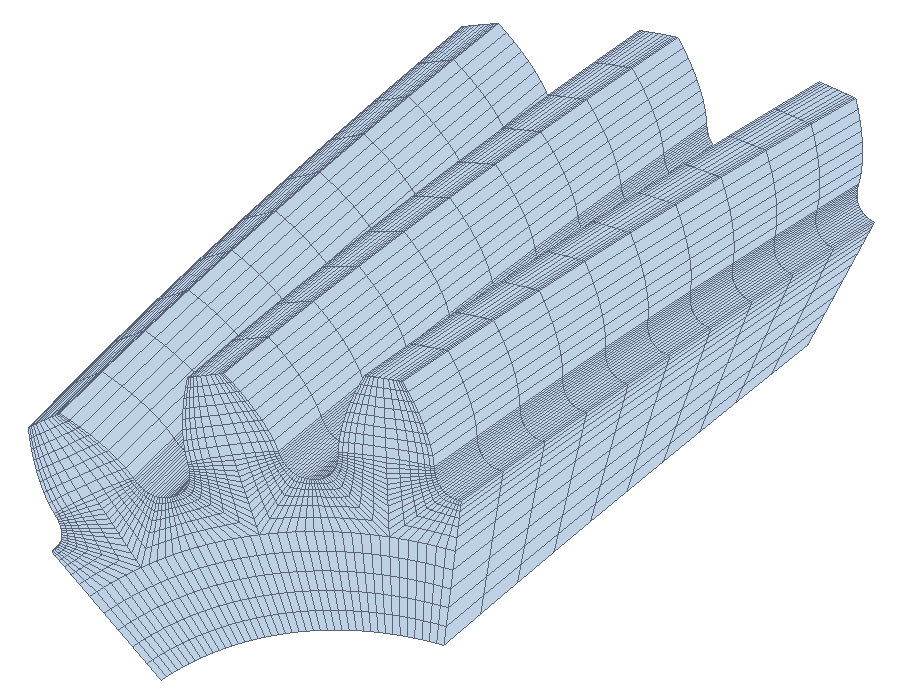
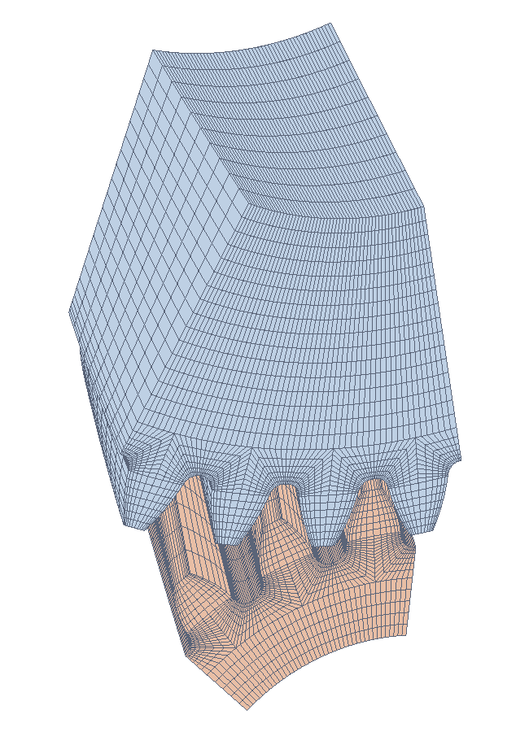

# Three-dimensional FEM

A transverse slice cannot show how a helical tooth twists across its width or how stress varies
near a free face. The package can build and solve 3D models for these questions. That capability
must be separated from validation: **this chapter documents the implemented 3D workflow, not a
validated 3D design result**.

## What changes from 2D?

| Aspect | 2D | 3D |
|---|---|---|
| Domain | Transverse section in plane strain | Finite-width volume |
| Mesh | Quadrilaterals | Extruded or twisted hexahedra |
| Displacements | In-plane | Three components |
| Applied force | Normalized per unit width | Total force over the modelled width |
| Reported torque | Per unit width | Total N·mm |
| Face effects | Not resolved | Can vary across width |
| Cost | Usually manageable for a sweep | Can grow rapidly with flank and width refinement |

For spur gears, extrusion preserves the section orientation. For helicals, the twist over width
$b$ is

$$\Delta\theta=\frac{b\tan\beta}{r},$$

with reference radius $r=d/2$. The pair generator gives the two members opposite hands. This
geometric extrusion is not a model of every possible manufacturing modification.





## Mesh the volume first

Continue {doc}`../quickstart`. This example controls the axial count explicitly; it is a mesh
inspection example, not a converged contact mesh:

```python
from dataclasses import replace
from gearbox.fem import ToothMeshSettings, mesh_pair

helical = replace(transmission,
    pinion=replace(transmission.pinion, helix_angle=15.0),
    wheel=replace(transmission.wheel, helix_angle=15.0))
settings_3d = ToothMeshSettings(
    flank_size=0.08, fillet_size=0.05,
    tooth_elements=10, width_elements=8, order=1,
)
volume_mesh = mesh_pair(helical, "out/3d_mesh", "helical_pair", "3D",
                       settings=settings_3d, teeth=(3, 4), formats=("msh",))
print(volume_mesh.node_count, volume_mesh.element_count, volume_mesh.min_quality)
```

The solver reader maps linear hexahedra to `C3D8I` and quadratic serendipity hexahedra to
`C3D20R`. Quadratic order adds degrees of freedom and does not remove the need to resolve the
contact band. Physical groups become surfaces (`FLANK`, `FILLET`, `BORE`) or volumes (`GEAR`),
with end faces `FACE_Z0` and `FACE_ZB`; pair prefixes remain unchanged.

Inspect the mesh in 3D: excessive twist per layer, slender elements, distorted fillets and too few
axial layers can all matter even when the minimum scaled Jacobian is positive.

## Three-dimensional bending

`solve_bending` defaults to 3D, but state the dimension explicitly for reproducible scripts.
The bore translations are fixed and a pressure band loads one flank. The total normal force is
$F_t/(\cos\alpha_t\cos\beta_b)$.

```python
from gearbox.fem import ElasticMaterial, solve_bending

# Illustrative solver invocation: not executed to produce a published 3D result here.
root_3d = solve_bending(
    helical, "out/3d_bending", dimension="3D", settings=settings_3d,
    material=ElasticMaterial(
        youngs_modulus=helical.pinion.material.elastic_modulus,
        poisson_ratio=helical.pinion.material.poissons_ratio,
    ),
)
```

The loaded band is at approximately constant radius across the width. It does **not** follow the
actual inclined instantaneous contact line of a helical pair. This is useful as a defined load
case, but it is not equivalent to a 3D tooth-contact analysis. Compare the reaction torque with
applied torque, inspect the tensile root field across the width and perform mesh and sector-size
studies before interpreting its maximum.

## Three-dimensional contact

The wheel bore is fixed in three translations. The pinion bore has prescribed in-plane rigid
rotation and fixed axial displacement. Those axial restraints can react helical thrust; they do
not model shaft or bearing compliance. Flank contact remains frictionless surface-to-surface
penalty contact.

```python
from gearbox.fem import CONTACT_SETTINGS, solve_contact

# Illustrative only: a full fine-width model may be computationally expensive.
contact_mesh_3d = replace(CONTACT_SETTINGS, width_elements=24, order=1)
contact_3d = solve_contact(
    helical, "out/3d_contact", dimension="3D", settings=contact_mesh_3d,
    teeth=(3, 4), tolerance=0.05,
)
```

The chosen 24 layers are an explicit example, **not a validated convergence prescription**.
The default contact flank size is 0.015 modules. If axial layers are chosen automatically from
that size, a 34 mm width at module 2.5 implies roughly 907 layers: multiplying a fine transverse
mesh by hundreds of layers quickly becomes expensive. Reducing `width_elements` makes a run
cheaper but may make the contact representation inaccurate.

The contact result exposes pressure, root stresses, displacement arrays, mesh and last-run files.
The same target-torque iteration and summary rescaling described in {doc}`contact` apply.
Successful torque matching proves equilibrium under the selected model; it does not prove
pressure convergence.

## A defensible convergence programme

1. Establish a small 2D spur reference at the same nominal line load and compare with Hertz.
2. Build the 3D mesh and inspect geometry, groups and constraints before solving.
3. Refine the flank and fillet independently from axial layers. Record all counts and material data.
4. Compare torque, contact area, peak pressure and root stress—not just one scalar peak.
5. Test penalty sensitivity and the number of teeth in each sector.
6. Check whether maxima occur at free edges or sharp tips, where local singular behaviour can
   prevent peak-stress convergence.
7. Only then extend the model to a sweep of mesh positions.

Do not assume a 3D solver run is more accurate than a well-resolved 2D reference simply because it
has more dimensions. Accuracy follows the model assumptions and convergence evidence.

## Scope and available evidence

External rack-generated gears, linear-elastic materials and frictionless contact are the current
basis. The full double-helical geometry, shaft/bearing system, measured manufacturing deviations,
flank relief, friction and plasticity are not supplied by these examples.

The published 2D checks do not establish a validated 3D error bound. No new 3D pressure result or
3D convergence study is asserted here; the expensive solver snippets above are documented for
users who can carry out that study. Existing 3D mesh images demonstrate geometry, not validation
of stress or contact pressure.
